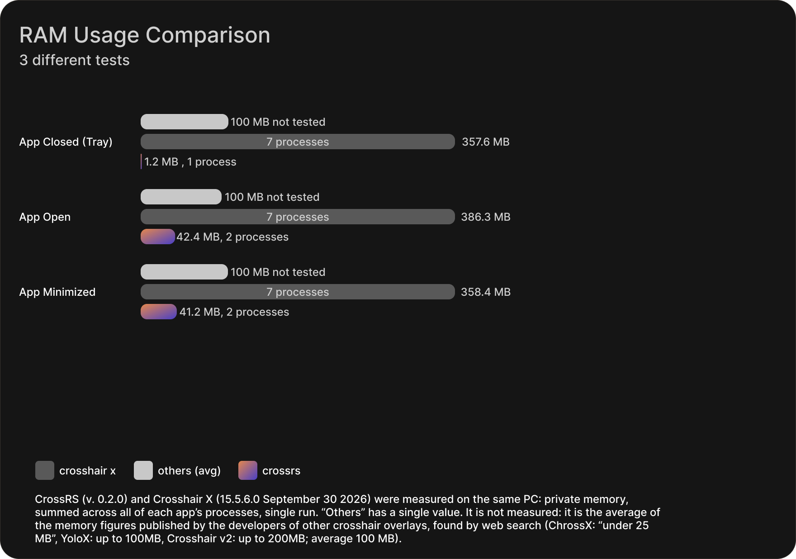

### CrossRS

**A crosshair overlay that uses 1.2 MB of RAM and no CPU.**

---

## Numbers

With its settings window closed, CrossRS is a single process using 1.2 MB of RAM and 0% CPU. Crosshair X, measured on the same PC, runs 7 processes and uses 358 MB in the tray, which makes CrossRS about 300 times lighter. Other overlays publish figures that average 100 MB, more than 80 times more. Even with the settings window open, CrossRS (2 processes, 42 MB) uses less than a ninth of what Crosshair X uses.

CrossRS (v. 0.2.0) and Crosshair X (15.5.6.0, September 30 2026) were measured on the same PC: private memory, summed across all of each app's processes, single run. "Others" has a single value. It is not measured: it is the average of the memory figures published by the developers of other crosshair overlays, found by web search (ChrossX: "under 25 MB", YoloX: up to 100 MB, Crosshair V2: up to 200 MB; average 100 MB).

To check it yourself, start CrossRS and run this in PowerShell:

## Why CrossRS

It draws the crosshair once and then stays idle, so there is no render loop to cost CPU or grow in memory. The overlay is click-through, always on top and never takes focus, and closing the settings leaves the crosshair on screen. It makes no network requests, injects nothing, hooks nothing, and has no accounts or community features. The executable is 5.6 MB, needs no installer, and draws in real pixels at any display scaling.

## Downsides

CrossRS is young and has limits. It is not registered with or verified by any anti-cheat, so use it at your own risk. There are no keybinds, you toggle it from the tray icon. It works in windowed and borderless modes only and cannot draw over exclusive fullscreen. It supports the primary monitor only, offers two shapes (cross and dot), and runs on Windows only.

## Free and maintained

CrossRS is free and keeps getting updates. There are no plans for a freemium model or a paid version. Suggestions are welcome and will be considered, always through one filter: performance. A feature that costs memory or CPU does not ship.

## Closed source

CrossRS is closed source on purpose. Its identity is how small and quiet it is, and keeping the implementation private keeps it one project instead of many forks. The claims above can be checked without the code: a firewall or Wireshark shows no network traffic, Process Monitor shows it never touches another process, and Task Manager shows the memory. All rights reserved.

## Install

Download `crossrs.exe` from [Releases](../../releases) and run it. Left-click the tray icon for settings, right-click for Hide / Show and Exit. The config lives in `%APPDATA%\CrossRS\config.json`.
